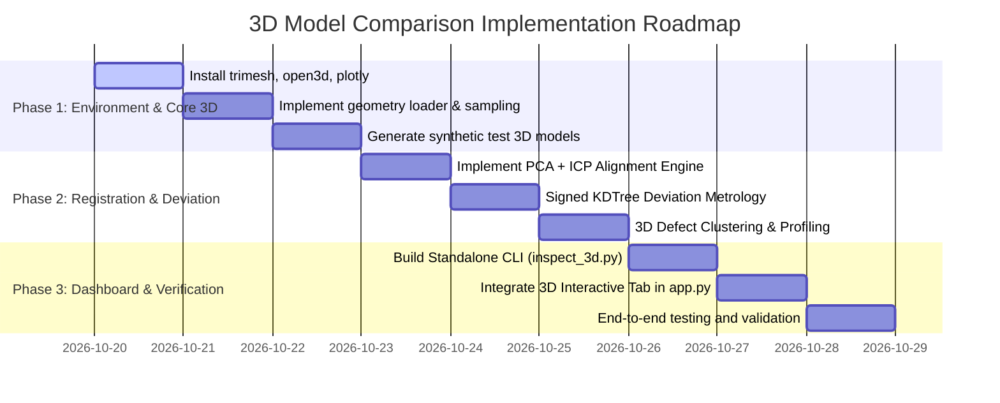

# 3D Model Comparison & Defect Inspection Architecture Blueprint

## Executive Summary

This document provides a comprehensive technical audit of the current automated inspection pipeline and details the architecture, mathematical formulations, library dependencies, and file modifications required to extend the system to **full 3D model comparison**. 

The extended system will ingest a **Golden/Ideal 3D reference model** and a **Test/Manufactured 3D model** (in formats such as `.stl`, `.obj`, `.ply`, or point clouds), perform automated 6-DoF spatial alignment (coarse registration + fine Iterative Closest Point), execute millimeter/micrometer-level surface deviation checks, isolate geometric anomalies (dents, cracks, warping, underfill, burrs), and render an automated **PASS / FAIL** operational verdict alongside an interactive 3D deviation heatmap.

---

## 1. What Has Been Implemented So Far

### 1.1 Architectural Foundations (Phases 1 to 7)
The current repository is an automated machine vision inspection framework built around Intel's **Anomalib 2.7.0** and **PyTorch 2.11.0 (CUDA 12.8)**, customized for the **NVIDIA RTX 5060 Laptop GPU (Blackwell `sm_120`)**.

```
[Current 2D Multi-View Architecture]

   Real-IAD Industrial Toothbrush (5 Cameras: C1, C2, C3, C4, C5)
                                │
               ┌────────────────┴────────────────┐
               ▼                                 ▼
      [C1..C5 Image Inputs]             [Reference Golden Part]
               │                                 │
   PatchCore Feature Extractor                   │
    (ResNet-18 / WideResNet-50)                  │
               │                                 │
   GPU Coreset Memory Bank Match                 │
   (Distance to nearest normal patch)            │
               │                                 │
     Anomaly Score per View                      │
               │                                 │
      Multi-View Engine                          │
     Score = max(C1 .. C5)                       │
               │                                 │
      Operational Threshold                      │
     (tau = 0.530 calibrated)                    │
               │                                 │
               ├───────────────────┬─────────────┘
               ▼                   ▼
      [Verdict: PASS/FAIL]  [5x Microscope PIP Callout]
                            - Target Reticle & Callout Card
                            - Flaw vs Golden Crop side-by-side
```

### 1.2 Core Modules in the Codebase

| File / Component | Primary Responsibility | Current State |
| :--- | :--- | :--- |
| [`configs/pipeline_config.yaml`](file:///e:/Projects/Cap%20Project/configs/pipeline_config.yaml) | Central YAML configuration for dataset paths, PatchCore backbone, coreset ratios, and multi-view rules. | Configured for 512px PatchCore with ResNet-18 / WideResNet-50 and 5 camera angles (`C1`–`C5`). |
| [`scripts/utils.py`](file:///e:/Projects/Cap%20Project/scripts/utils.py) | Vectorized GPU Coreset monkey-patch for Blackwell `sm_120`. | Overrides `KCenterGreedy` to execute distance operations directly in CUDA VRAM (reducing indexing from 10 min to 3 sec). |
| [`scripts/inference_engine.py`](file:///e:/Projects/Cap%20Project/scripts/inference_engine.py) | Self-contained GPU inference pipeline (`ToothbrushInspector`). | Real-time inference (<40 ms), anomaly map generation, connected-component contour extraction, OOD detection, and HUD overlay generation. |
| [`scripts/inspect_part.py`](file:///e:/Projects/Cap%20Project/scripts/inspect_part.py) | CLI single-part inspection tool. | Generates annotated HUD with bounding brackets, leader lines, and 5x microscopic PIP zoom against golden standard crops. |
| [`scripts/multiview_eval.py`](file:///e:/Projects/Cap%20Project/scripts/multiview_eval.py) | Multi-view aggregation engine. | Evaluates 5-camera parts (`max_score` aggregation), demonstrating elimination of single-camera blind spots (AUROC: 85.34%). |
| [`scripts/synthetic_defect_generator.py`](file:///e:/Projects/Cap%20Project/scripts/synthetic_defect_generator.py) | Procedural 2D defect generator. | Injects realistic scratches, dents, chips, and cracks onto normal images for training and testing validation. |
| [`scripts/baseline.py`](file:///e:/Projects/Cap%20Project/scripts/baseline.py) & [`scripts/model_comparison.py`](file:///e:/Projects/Cap%20Project/scripts/model_comparison.py) | Training and model benchmarking suite. | Compares PatchCore, PaDiM, and EfficientAD across resolutions (256, 512, 1024), measuring VRAM, latency, and AUROC. |
| [`scripts/audit.py`](file:///e:/Projects/Cap%20Project/scripts/audit.py) & [`scripts/viz.py`](file:///e:/Projects/Cap%20Project/scripts/viz.py) | Data audit and 4-panel visualizer. | Audits defect area distributions (micro/medium/large) and produces publication-grade 4-panel figures (Raw, Mask, Heatmap, Decision). |
| [`app.py`](file:///e:/Projects/Cap%20Project/app.py) | Interactive Streamlit Inspection Dashboard. | Industrial dark-slate UI, real-time GPU inference, threshold slider, OOD alerts, defect localization, and microscope comparison. |

---

## 2. The 3D Problem Statement

### 2.1 Why Extend from 2D to 3D?
While the current 2D multi-view system successfully inspects visible surfaces from five fixed camera angles, manufactured physical objects (e.g., molded plastic caps, toothbrushes, machined metal parts, turbine blades, medical implants) exhibit defects that 2D cameras struggle to quantify:

1. **Occlusion & Undercuts:** Recessed cavities, internal threads, and overhangs cannot be captured from fixed 2D planar cameras.
2. **Perspective & Lighting Artifacts:** Shadows, specular glints, reflections, and camera distortion can mimic defects or conceal hairline cracks.
3. **Absence of Quantitative Metrology:** 2D inspection outputs pixel areas, but cannot verify whether a surface has sagged by $0.4\,\text{mm}$, warped across its axis, or exceeded a dimensional tolerance of $\pm 0.15\,\text{mm}$.
4. **CAD Non-Conformance:** In modern digital manufacturing (Industry 4.0), quality assurance requires directly comparing a physical 3D scan against the design authority: the **Nominal CAD model** (STL/STEP/OBJ).

### 2.2 Objective of the 3D Extension
Create an end-to-end **3D Model Comparison & Metrology Inspection Module** that:
- Ingests **two 3D models**:
  1. **Ideal / Golden Model** ($M_{\text{ref}}$): Nominal CAD design or golden scan (Mesh or Point Cloud).
  2. **Inspected / Test Model** ($M_{\text{test}}$): The manufactured physical scan or new 3D model.
- Automatically handles **arbitrary translation, rotation, and scale variations** using robust 3D registration.
- Conducts a thorough **360° full-volume geometric audit** computing continuous surface deviation fields.
- Detects and categorizes 3D physical flaws:
  - **Material Deficit (Underfill / Dents / Cracks / Chipping):** Negative deviation ($d < -\tau$).
  - **Material Excess (Burrs / Flash / Inclusions / Swelling):** Positive deviation ($d > +\tau$).
  - **Global Distortion (Warping / Shrinkage / Thermal Sag):** Gradient deviation across axes.
- Returns a definitive **PASS / FAIL** verdict based on industrial tolerance bands (GD&T).
- Provides an **interactive 3D inspection viewer** in the dashboard with continuous color-mapped deviation fields, defect cluster callouts, and cross-section slicing.

---

## 3. Mathematical Foundations of 3D Model Comparison

```
[3D Model Comparison Mathematical Workflow]

      Ideal 3D Model (Ref)                Inspected 3D Model (Test)
              │                                      │
              ▼                                      ▼
     [Mesh / Point Cloud]                   [Mesh / Point Cloud]
              │                                      │
              └───────────────┬──────────────────────┘
                              ▼
                1. Spatial Standardization
                - Centering to origin: P -> P - mu
                - Scale verification / normalization
                              │
                              ▼
                2. 6-DoF Global Alignment
                - Coarse: Principal Axis Alignment (PCA)
                          or FPFH RANSAC Registration
                - Fine: Point-to-Plane / Robust ICP
                        min_{R, t} sum || (R * p_i + t - q_i) . n_i ||^2
                              │
                              ▼
                3. Signed Surface Deviation Metrology
                - KD-Tree Euclidean Distance: d_i = || p_i - q_nn ||
                - Signed Distance: s_i = sign((p_i - q_nn) . n_nn) * d_i
                              │
                              ▼
                4. Statistical Tolerance Decision Engine
                - d_max = max(|s_i|)
                - RMSE = sqrt( 1/N sum s_i^2 )
                - Defect Ratio = count(|s_i| > tau) / N
                - Decision: FAIL if (d_max > tau_peak OR Defect Ratio > tau_area)
                              │
                              ▼
                5. 3D Spatial Defect Clustering
                - DBSCAN / Euclidean clustering on outlier points
                - Isolate Defect #1 (Dent), Defect #2 (Burr) with 3D centroids
```

### 3.1 6-DoF Rigid Body Registration (ICP)
The scanned object is rarely in the exact coordinate frame of the ideal model. We solve for the optimal rotation matrix $R \in \text{SO}(3)$ and translation vector $\mathbf{t} \in \mathbb{R}^3$ that aligns $M_{\text{test}} = \{ \mathbf{p}_i \}_{i=1}^{N_p}$ with $M_{\text{ref}} = \{ \mathbf{q}_j \}_{j=1}^{N_q}$:

$$\min_{R, \mathbf{t}} \sum_{i=1}^{N_p} \left\| \left( R \mathbf{p}_i + \mathbf{t} - \mathbf{q}_{\pi(i)} \right) \cdot \mathbf{n}_{\pi(i)} \right\|^2$$

where $\pi(i) = \arg\min_j \| R \mathbf{p}_i + \mathbf{t} - \mathbf{q}_j \|$ is the nearest neighbor in the reference model and $\mathbf{n}$ is the surface normal at that point.

### 3.2 Signed Surface Deviation Computation
For every point $\mathbf{p}_i$ on the aligned test object, we compute its distance to the closest point or triangular facet on the reference model:
$$d_i = \min_{\mathbf{q} \in M_{\text{ref}}} \| \mathbf{p}_i - \mathbf{q} \|$$

To distinguish between **missing material (dents/cracks)** and **excess material (burrs/swelling)**, we compute the signed distance using reference surface normals $\mathbf{n}_{\text{ref}}$:
$$s_i = \operatorname{sign}\left( (\mathbf{p}_i - \mathbf{q}_{\text{ref}}) \cdot \mathbf{n}_{\text{ref}} \right) \cdot d_i$$
- $s_i < -\tau$: **Deficit / Pit / Crack / Erosion** (Hole or Dent)
- $-\tau \le s_i \le +\tau$: **In Specification** (Nominal Surface)
- $s_i > +\tau$: **Excess Material / Burr / Flash / Warping Outward**

### 3.3 Metrology Metrics & Decision Rule

| Metric | Formula | Industrial Meaning |
| :--- | :--- | :--- |
| **Max Deviation ($d_{\max}$)** | $\max_i \| s_i \|$ | Worst-case peak flaw depth or height. |
| **Root Mean Square Error ($\text{RMSE}$)** | $\sqrt{\frac{1}{N} \sum_{i=1}^N s_i^2}$ | Overall geometric fidelity / global distortion. |
| **Mean Absolute Deviation ($\text{MAE}$)** | $\frac{1}{N} \sum_{i=1}^N \| s_i \|$ | Average surface roughness / dimensional drift. |
| **Defective Surface Ratio ($\rho_{\text{defect}}$)** | $\frac{\sum_{i=1}^N \mathbb{I}(\| s_i \| > \tau)}{N}$ | Percentage of total surface area out of tolerance. |

**Unified Decision Rule:**
$$\text{Verdict} = \begin{cases} \mathbf{FAIL} & \text{if } d_{\max} \ge \tau_{\text{peak}} \;\lor\; \text{RMSE} \ge \tau_{\text{rmse}} \;\lor\; \rho_{\text{defect}} \ge \tau_{\text{area}} \\ \mathbf{PASS} & \text{otherwise} \end{cases}$$

---

## 4. Required Dependencies & Sources

The project's virtual environment (`.venv` on Python 3.11) already contains `torch`, `torchvision`, `scipy` (cKDTree), `numpy`, `streamlit`, and `matplotlib`.

To support comprehensive 3D file formats, mesh processing, and interactive 3D WebGL rendering, the following packages are needed:

```bash
# Core 3D Mesh and Point Cloud Processing
.\.venv\Scripts\python.exe -m pip install trimesh open3d

# Interactive 3D WebGL Visualization in Streamlit
.\.venv\Scripts\python.exe -m pip install plotly

# Fast KDTree acceleration (scipy is already installed)
```

### Dependency Breakdown:
1. **`trimesh`**:
   - Universal loader for `.stl`, `.obj`, `.ply`, `.glb`, `.3mf`, `.off`.
   - Mesh repair, surface sampling, triangle ray-casting, bounding boxes, inertia tensors.
   - Zero heavyweight system dependencies; works seamlessly on Windows.
2. **`scipy.spatial.cKDTree`**:
   - Already installed in `.venv`.
   - Computes Euclidean nearest-neighbor distances for 100,000 points in $<15\,\text{ms}$.
3. **`open3d`** (or vectorized NumPy ICP):
   - Fast Point-to-Plane ICP, voxel downsampling, normal estimation, FPFH feature matching.
4. **`plotly.graph_objects`**:
   - Renders hardware-accelerated 3D meshes (`go.Mesh3d`) and 3D colored point clouds (`go.Scatter3d`) inside Streamlit with interactive 360° mouse rotation, pan, zoom, and continuous colorbars.

---

## 5. File-by-File Changes & Extension Plan

### 5.1 New Modules to Add

```
e:\Projects\Cap Project\
├── scripts/
│   ├── geometry_3d/                       <-- NEW 3D SUBPACKAGE
│   │   ├── __init__.py
│   │   ├── loader.py                      <-- Ingests STL, OBJ, PLY, PCD
│   │   ├── alignment.py                   <-- PCA coarse + Point-to-Plane ICP
│   │   ├── comparator.py                  <-- Signed distance & metrology engine
│   │   ├── clustering.py                  <-- DBSCAN 3D defect site segmentation
│   │   └── synthetic_3d.py                <-- Procedural 3D CAD defect generator
│   ├── inspect_3d.py                      <-- Standalone CLI for 3D model comparison
│   └── test_3d_pipeline.py                <-- Automated verification test suite
├── samples_3d/                            <-- Golden & Defective 3D models catalog
│   ├── golden_part.stl                    <-- Nominal reference model
│   ├── part_with_dent.stl                 <-- Defective: Indentation / cavity
│   ├── part_with_burr.stl                 <-- Defective: Excess flash / protrusion
│   └── part_warped.stl                    <-- Defective: Structural bending
└── app.py                                 <-- Dashboard updated with 3D Inspector Tab
```

### 5.2 Detailed Implementation Breakdown

#### Module 1: `scripts/geometry_3d/loader.py`
- Ingests STL, OBJ, PLY, PCD, GLB files via `trimesh` and `open3d`.
- Uniformly samples high-density surface point clouds from meshes ($N = 50,000$ to $200,000$ points) ensuring uniform surface coverage even on complex geometry.
- Computes outward-pointing surface normals.

#### Module 2: `scripts/geometry_3d/alignment.py`
- **Coarse Registration:** Center-of-mass centering followed by Principal Component Analysis (PCA) alignment of principal inertia axes.
- **Fine Registration (ICP):** Point-to-Plane Iterative Closest Point algorithm with robust Huber loss to prevent defect regions from biasing the alignment of the intact body.
- Returns aligned point clouds and the transformation matrix $T \in \text{SE}(3)$.

#### Module 3: `scripts/geometry_3d/comparator.py`
- Builds a dual `cKDTree` (reference model and test model).
- Computes signed bidirectional distances:
  - Test-to-Reference (detects extra material / burrs).
  - Reference-to-Test (detects missing material / holes / dents).
- Calculates $d_{\max}$, $\text{RMSE}$, $\text{MAE}$, and Defect Surface Ratio.
- Determines the operational verdict: **PASS** or **REJECT**.

#### Module 4: `scripts/geometry_3d/clustering.py`
- Extracts points exceeding tolerance ($\|s_i\| > \tau$).
- Applies 3D Euclidean / DBSCAN clustering to separate distinct defect sites.
- Profiles each defect: 3D bounding box, peak centroid, maximum depth/height in mm, defect surface area.

#### Module 5: `scripts/geometry_3d/synthetic_3d.py`
- Procedural generator to create sample 3D objects (e.g. toothbrush head with bristles, industrial caps, cylindrical shafts) and inject controllable geometric defects:
  - Spherical indentations (dents).
  - Surface gouges / cracks.
  - Extrusion bumps (burrs).
  - Non-linear bending / warping.
- Ensures immediate out-of-the-box testing without waiting for external CAD files.

#### Module 6: `scripts/inspect_3d.py`
- Command-line tool callable from PowerShell:
  ```powershell
  python scripts/inspect_3d.py --ideal samples_3d/golden.stl --test samples_3d/scanned.stl --tolerance 0.20
  ```
- Outputs structured JSON inspection logs and HTML/PNG 3D visual reports.

#### Module 7: Upgrades to `app.py`
- Add a top-level mode selector or tabbed navigation:
  - **Tab 1: 📷 2D Multi-View Optical Inspection** (The existing, fully-functional PatchCore pipeline).
  - **Tab 2: 🧊 3D CAD & Mesh Metrology Inspection** (The new 3D model comparison engine).
- Dual 3D file uploaders (or preset library): Upload Ideal 3D Model + Upload Test 3D Model.
- Tolerance sensitivity controls:
  - Dimensional tolerance band ($\pm \tau$ in mm / relative units).
  - Max allowable defect surface percentage.
- **Interactive Plotly 3D Viewport**:
  - Full 360° mouse rotation, panning, and zoom.
  - Heatmap color toggle: Signed deviation (`Jet` / `RdYlGn` / `Coolwarm`).
  - Overlay mode: Ideal wireframe superimposed on scanned mesh.
  - Defect site markers highlighting pinpoint 3D coordinates.

---

## 6. Comparison: 2D Multi-View vs. 3D Model Inspection

| Capability | Current 2D System | Extended 3D System | Hybrid System (Combined) |
| :--- | :--- | :--- | :--- |
| **Input Data** | 5 High-res RGB images ($C_1..C_5$) | 3D Mesh / Point Cloud (STL, OBJ, PLY) | 3D Model + High-res surface textures |
| **Core Method** | Deep PatchCore patch anomaly matching | 6-DoF ICP Alignment + Signed Metrology | ICP Deviation + Projected PatchCore |
| **Defect Detection** | Surface color/texture flaws, missing bristles | Geometric deviations, dents, burrs, warp | 100% surface texture + dimensional GD&T |
| **Measurement Unit**| Normalized anomaly score (0.0 to 1.0) | True metric dimensional units ($\text{mm} / \mu\text{m}$) | Millimeters + Feature anomaly score |
| **Inspection Scope**| 5 directional viewpoints | Complete 360° external & internal geometry | 360° volumetric and optical inspection |
| **Verdict Basis** | Calibrated threshold ($\tau = 0.530$) | Engineering tolerance limits ($\pm \tau_{\text{mm}}$) | Dual-gate: Geometric AND Cosmetic PASS |

---

## 7. Phased Implementation Roadmap



### Next Steps for Implementation:
1. **Approval of Blueprint:** Review and approve this comprehensive architecture plan.
2. **Environment Setup:** Install `trimesh`, `open3d`, and `plotly` in `.venv`.
3. **Core Development:** Create `scripts/geometry_3d/` with loader, alignment, and deviation modules.
4. **Sample Generation:** Generate golden reference and defective test 3D models (`samples_3d/`).
5. **UI Integration:** Add the 3D Metrology Inspector tab to [`app.py`](file:///e:/Projects/Cap%20Project/app.py) with real-time Plotly 3D WebGL rendering.
