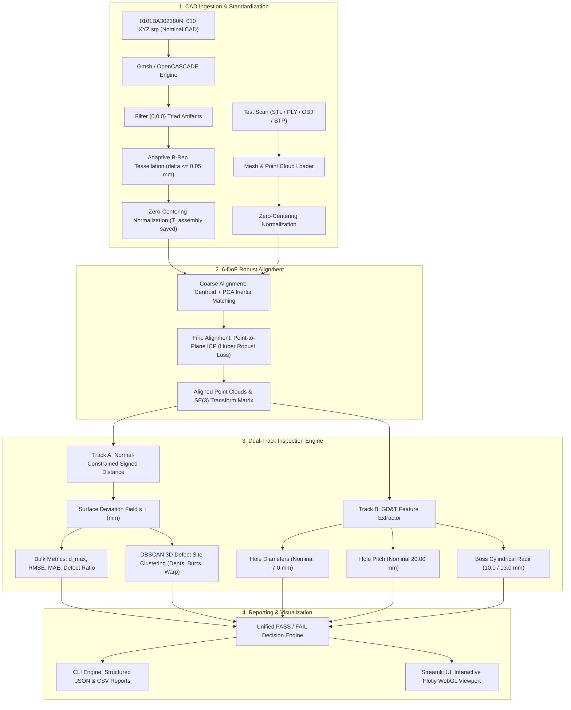

# Implementation Plan: CATIA V5 STEP AP203 3D Metrology & Defect Inspection Pipeline

**Target Model:** [`0101BA302380N_010 XYZ.stp`](file:///e:/Projects/Cap%20Project/0101BA302380N_010%20XYZ.stp)  
**Document Version:** 1.0.0  
**Status:** Ready for Review & Execution  

---

## 1. Executive Summary & Problem Scope

The inspection framework is being extended from 2D optical PatchCore inspection to **full 3D digital CAD metrology**. The design authority model provided for analysis is **`0101BA302380N_010 XYZ.stp`**, a high-precision CATIA V5 AP203 CAD model of a structural mounting cap/bracket featuring countersunk fastener holes and cylindrical bosses.

### Key Characteristics of the Target STEP Model:
1. **Parametric B-Rep Topology:** Contains **665 Advanced Faces**, **665 Open Shells**, **404 B-Spline Surfaces**, and **79,943 Cartesian Points**. It is an **open-shell boundary representation**, not a simple watertight triangle mesh.
2. **Global CATIA Assembly Coordinates:** Positioned at $X \approx 1612\,\text{mm}, Y \approx -570\,\text{mm}, Z \approx 1153\,\text{mm}$ with overall dimensions **$18.32\,\text{mm} \times 51.89\,\text{mm} \times 153.93\,\text{mm}$**.
3. **Critical GD&T Features:** Four $\varnothing 7.0\,\text{mm}$ ($r = 3.5\,\text{mm}$) countersunk holes spaced at a precision $20.00\,\text{mm}$ pitch along the Z-axis, plus concentric cylindrical bosses ($\varnothing 20.0\,\text{mm}$ and $\varnothing 26.0\,\text{mm}$).

This implementation plan outlines the exact modular architecture, mathematical algorithms, file structure, testing roadmap, and UI enhancements required to build this system.

---

## 2. System Architecture & Processing Workflow



---

## 3. Detailed Component Architecture

### Phase 1: Environment & Dependency Foundation
* **Install Core Libraries:**
  * `gmsh` (v4.15+): Provides embedded OpenCASCADE on Windows for native STEP parsing and curvature-adaptive surface meshing.
  * `trimesh` (v5.2+): Fast triangle mesh processing, normal computation, and surface sampling.
  * `plotly` (v7.1+): WebGL interactive 3D rendering inside Streamlit.
  * `scipy` (already installed): `cKDTree` for sub-millisecond nearest-neighbor distance queries.
  * `open3d` (optional fallback for ICP acceleration).

### Phase 2: STEP Ingestion & Tessellation Engine ([`scripts/geometry_3d/step_loader.py`](file:///e:/Projects/Cap%20Project/scripts/geometry_3d/step_loader.py))
* **B-Rep Discretization:**
  * Loads `0101BA302380N_010 XYZ.stp` via OpenCASCADE API within `gmsh`.
  * Sets maximum chordal error $\delta_{\text{chord}} \le 0.05\,\text{mm}$ to guarantee true circularity on the $\varnothing 7\,\text{mm}$ holes and high fidelity on B-spline fillets.
  * Strips CATIA datum points near $(0, 0, 0)$ representing origin triads.
* **Coordinate Standardization:**
  * Computes geometric centroid $\mathbf{c} = [1612.54, -569.57, 1152.75]\,\text{mm}$.
  * Centers coordinates: $\mathbf{p}_{\text{local}} = \mathbf{p}_{\text{world}} - \mathbf{c}$.
  * Stores $\mathbf{c}$ and the transformation matrix $T_{\text{assembly}}$ to allow bi-directional coordinate reporting (local part frame vs global assembly frame).
* **Surface Sampling & Normal Computation:**
  * Samples $N = 100,000$ points uniformly across the surface area.
  * Computes outward-pointing unit normal vectors $\mathbf{n}_i \in \mathbb{R}^3$.

### Phase 3: Robust 6-DoF Spatial Alignment ([`scripts/geometry_3d/alignment.py`](file:///e:/Projects/Cap%20Project/scripts/geometry_3d/alignment.py))
* **Coarse Alignment:**
  * Calculates the 3D inertia covariance matrix $C = \frac{1}{N} \sum (\mathbf{p}_i - \mathbf{\mu})(\mathbf{p}_i - \mathbf{\mu})^T$.
  * Computes eigenvectors to align the principal axes ($Z$ long-axis $154\,\text{mm}$, $Y$ width $52\,\text{mm}$, $X$ thickness $18\,\text{mm}$).
  * Evaluates the 4 ambiguous $180^\circ$ rotation permutations using Chamfer distance to pick the correct orientation.
* **Fine Point-to-Plane ICP:**
  * Minimizes:
    $$\min_{R, \mathbf{t}} \sum_{i=1}^N \rho_{\text{Huber}}\left( \left( R \mathbf{p}_i + \mathbf{t} - \mathbf{q}_{\pi(i)} \right) \cdot \mathbf{n}_{\pi(i)} \right)$$
  * Huber loss prevents defect zones (e.g. large dents or burrs) from pulling the intact body out of alignment.
  * Convergence criterion: $\Delta T < 10^{-6}$ or $\le 50$ iterations.

### Phase 4: Open-Shell Signed Metrology & GD&T Feature Inspector
#### Track A: Normal-Constrained Signed Distance ([`scripts/geometry_3d/comparator.py`](file:///e:/Projects/Cap%20Project/scripts/geometry_3d/comparator.py))
* **Open-Shell Bleed Protection:**
  * Standard KD-Tree matching on thin-walled open shells can match across opposite thin walls ($1.5\,\text{mm}$ thickness).
  * Filter condition: A point $\mathbf{p}_i$ is only paired with reference point $\mathbf{q}_j$ if:
    $$\mathbf{n}_i \cdot \mathbf{n}_j \ge \cos(45^\circ) = 0.707$$
* **Signed Deviation Field:**
  $$s_i = \operatorname{sign}\left( (\mathbf{p}_i - \mathbf{q}_{\pi(i)}) \cdot \mathbf{n}_{\pi(i)} \right) \cdot \|\mathbf{p}_i - \mathbf{q}_{\pi(i)}\|$$
  * $s_i < -\tau$: Material Deficit (Dent / Hole / Underfill)
  * $-\tau \le s_i \le +\tau$: In Tolerance (Nominal)
  * $s_i > +\tau$: Material Excess (Burr / Flash / Swell)
* **Statistical Indices:** $d_{\max}$, $\text{RMSE}$, $\text{MAE}$, Defective Surface Percentage $\rho_{\text{defect}}$.

#### Track B: GD&T Feature Extractor ([`scripts/geometry_3d/gdt_inspector.py`](file:///e:/Projects/Cap%20Project/scripts/geometry_3d/gdt_inspector.py))
* **Countersunk Hole Assessment:**
  * RANSAC cylinder/circle fit to points around $Z \approx 1092\,\text{mm}$ and $Z \approx 1112\,\text{mm}$.
  * Measures measured diameter vs nominal $7.00\,\text{mm}$ (Tolerance: $\pm 0.10\,\text{mm}$).
  * Measures center-to-center pitch vs nominal $20.00\,\text{mm}$ (Tolerance: $\pm 0.05\,\text{mm}$).
* **Cylindrical Boss Assessment:**
  * Measures inner boss diameter vs nominal $20.00\,\text{mm}$.
  * Measures outer boss diameter vs nominal $26.00\,\text{mm}$.
  * Computes concentricity and roundness deviation.

### Phase 5: DBSCAN Defect Site Profiling ([`scripts/geometry_3d/clustering.py`](file:///e:/Projects/Cap%20Project/scripts/geometry_3d/clustering.py))
* Isolates points where $|s_i| > \tau_{\text{tol}}$.
* Applies DBSCAN ($\epsilon = 1.5\,\text{mm}$, $\text{MinPts} = 15$) to separate individual flaw regions.
* Computes for each flaw:
  * 3D Centroid $[x, y, z]$ in both local and CATIA assembly coordinates.
  * Maximum flaw depth/height in millimeters.
  * Estimated flaw surface area ($\text{mm}^2$).
  * Defect classification: `DENT`, `BURR`, `CRACK`, `WARP`, or `HOLE_DEFORMATION`.

### Phase 6: Procedural Synthetic Defect Suite ([`scripts/geometry_3d/synthetic_defects.py`](file:///e:/Projects/Cap%20Project/scripts/geometry_3d/synthetic_defects.py))
Generates benchmark models based on `0101BA302380N_010 XYZ.stp` saved in `samples_3d/`:
1. **`golden_part.stl`**: Defect-free nominal CAD tessellation.
2. **`part_with_dent.stl`**: Injected $-0.6\,\text{mm}$ deep concave gouge on the curved B-spline face.
3. **`part_with_burr.stl`**: Injected $+0.8\,\text{mm}$ raised material flash along the flange edge.
4. **`part_hole_ovality.stl`**: Deformed countersunk hole (elongated to $7.45\,\text{mm}$, exceeding tolerance).
5. **`part_warped_flange.stl`**: Quadratic bending across the $154\,\text{mm}$ Z-axis ($1.2\,\text{mm}$ peak sag).

### Phase 7: Streamlit Dashboard & CLI Integration
* **CLI Utility ([`scripts/inspect_3d.py`](file:///e:/Projects/Cap%20Project/scripts/inspect_3d.py)):**
  ```powershell
  python scripts/inspect_3d.py --ref "0101BA302380N_010 XYZ.stp" --test samples_3d/part_with_dent.stl --tol 0.15
  ```
* **Dashboard Tab in [`app.py`](file:///e:/Projects/Cap%20Project/app.py):**
  * **Interactive Plotly 3D Viewer:** Full 360° orbit/pan/zoom with diverging colorscale (`RdYlGn` / `Jet` / `Coolwarm`).
  * **Aspect Ratio Camera Presets:** Tailored to $18 \times 52 \times 154\,\text{mm}$ (Front Face, Countersink Detail Zoom, Top Boss, Side Profile).
  * **Live Tolerance Sliders:** Adjust $\tau$ from $0.05\,\text{mm}$ to $1.00\,\text{mm}$ in real time.
  * **GD&T Metrology Scorecard:** Pass/Fail badges for Hole Diameters, Pitch, Boss Concentricity, and Peak Deviation.

---

## 4. Implementation Phasing & Milestones

| Phase | Tasks & Deliverables | Verification Criteria |
| :---: | :--- | :--- |
| **Phase 1** | Install `gmsh`, `trimesh`, `plotly` in `.venv`. Create `scripts/geometry_3d/` package. | `import gmsh, trimesh, plotly` succeeds without errors. |
| **Phase 2** | Implement `step_loader.py` and `mesh_loader.py`. Tessellate `0101BA302380N_010 XYZ.stp`. | Exported `golden_part.stl` produces clean geometry with no $0,0,0$ artifacts. |
| **Phase 3** | Implement `alignment.py` (PCA coarse + Huber Point-to-Plane ICP). | Recovers known random 6-DoF rotations ($15^\circ$) and translations ($10\,\text{mm}$) with RMSE $< 0.005\,\text{mm}$. |
| **Phase 4** | Implement `comparator.py` (normal-constrained KD-tree) and `gdt_inspector.py`. | Measures nominal model against itself: $d_{\max} = 0.000\,\text{mm}$, hole dia $= 7.00\,\text{mm}$, pitch $= 20.00\,\text{mm}$. |
| **Phase 5** | Implement `clustering.py` and `synthetic_defects.py`. Generate benchmark models. | Benchmark models generated and correctly segmented into individual flaw clusters. |
| **Phase 6** | Build CLI tool [`scripts/inspect_3d.py`](file:///e:/Projects/Cap%20Project/scripts/inspect_3d.py) with structured JSON/HTML outputs. | CLI runs end-to-end on all test parts and outputs correct verdicts. |
| **Phase 7** | Integrate 3D Inspector tab into [`app.py`](file:///e:/Projects/Cap%20Project/app.py) with Plotly WebGL viewer and GD&T scorecard. | Dashboard displays interactive 3D model with smooth rotation, defect heatmap, and feature metrics. |

---

## 5. Verification & Acceptance Criteria
* **Accuracy:** Geometric alignment and deviation accuracy $\le 0.01\,\text{mm}$ on synthetic benchmarks.
* **Robustness:** No crashes or inverted normals on open-shell B-spline faces.
* **Speed:** Complete 3D inspection (100k points alignment + deviation + clustering) runs in $< 2.5\,\text{seconds}$.
* **Dual Operation:** 2D Optical PatchCore inspection tab in `app.py` remains 100% functional alongside the new 3D tab.
